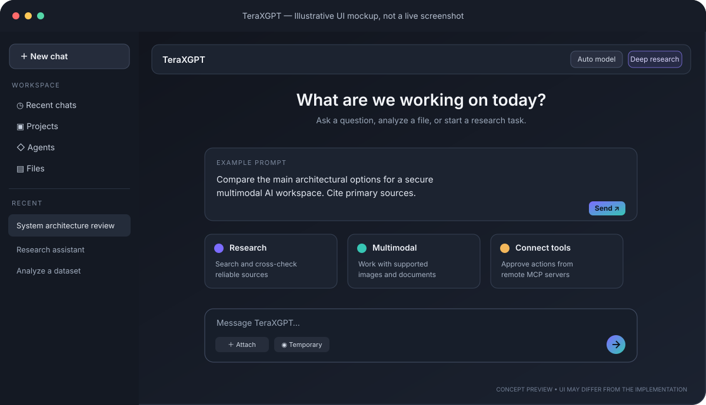
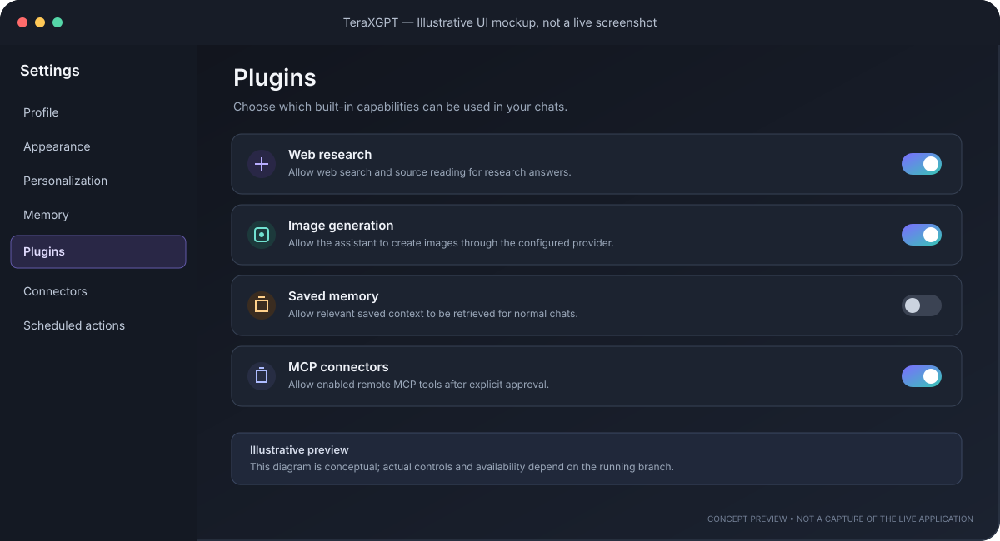
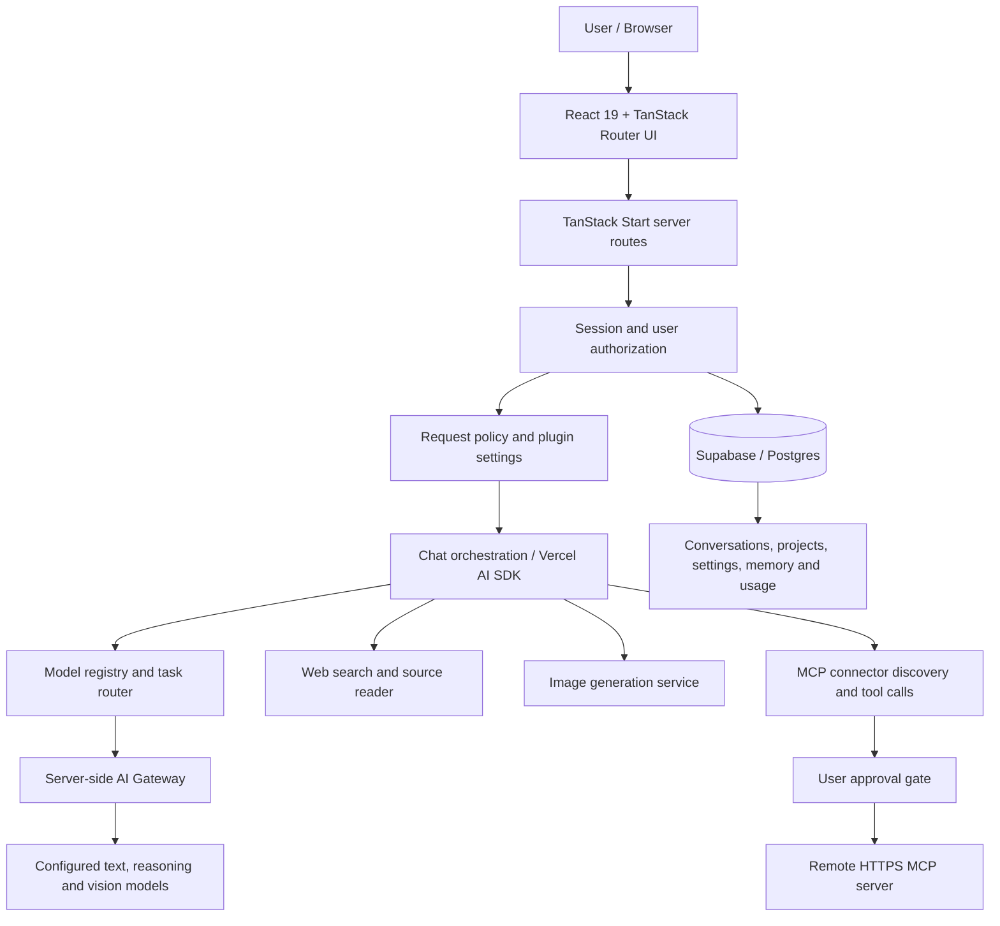

# TeraXGPT

**A model-routed, multimodal AI workspace with research tools, projects, agents, and MCP connectors.**

TeraXGPT brings chat, model selection, web research, image generation, saved context, project workspaces, and tool integrations into one web application. It is designed as a capability-first workspace: the app routes a request to a configured model and exposes only the tools allowed by the user's settings and the current chat mode.

> **Project status:** active development. This repository is not yet feature-equivalent to ChatGPT, Claude, or Gemini. Some capabilities depend on provider configuration, database migrations, and deployment secrets. Review [current feature status](docs/WORKSPACE_FEATURES.md) before deploying.

<p align="center">
  
</p>

<p align="center">
  <a href="#features">Features</a> ·
  <a href="#system-architecture">Architecture</a> ·
  <a href="#getting-started">Get started</a> ·
  <a href="docs/WORKSPACE_FEATURES.md">Feature status</a> ·
  <a href="docs/MCP_CONNECTORS.md">MCP setup</a>
</p>

## Contents

- [Features](#features)
- [UI previews](#ui-previews)
- [System architecture](#system-architecture)
- [Technology stack](#technology-stack)
- [Getting started](#getting-started)
- [Environment variables](#environment-variables)
- [Database migrations](#database-migrations)
- [Security notes](#security-notes)
- [Project structure](#project-structure)
- [Development commands](#development-commands)
- [Limitations and roadmap](#limitations-and-roadmap)
- [Contributing](#contributing)
- [License](#license)

## Features

### AI workspace
- Streaming chat built with the Vercel AI SDK and a server-side AI gateway.
- Central model registry and deterministic task routing for general chat, coding, reasoning, long-context/file requests, vision, and image generation.
- Image/file attachments where supported by the configured model and provider.
- Markdown and code-oriented response rendering.
- Conversation history, projects, agents, skills, and saved personalization/context.

### Research and multimodal tools
- **Deep Research mode:** research-oriented prompting, web search, source reading, source cross-checking, and citation guidance.
- **Image generation:** server-side image generation tool when configured and enabled.
- **Image understanding:** requests containing an image are routed to a configured vision-capable model.
- **Optional Hermes Agent runtime:** route a fresh chat to a separately hosted Hermes Agent service using its OpenAI-compatible API. See [Hermes Agent setup](docs/HERMES_AGENT.md); the standard TeraXGPT engine remains the default.
- **Usage tracking:** request/model usage metadata is recorded by the application.

### Privacy and extensibility
- **Temporary Chat:** conversation transcript and conversation records are not persisted for temporary requests. Usage metadata may still be stored; see [the limitations](docs/WORKSPACE_FEATURES.md).
- **Plugin settings:** per-user controls for web research, image generation, saved memory, and MCP connectors.
- **Remote MCP connectors:** connect to remote HTTPS MCP servers, encrypt bearer-token credentials at rest, inspect available tools, and require explicit approval before executing a connector tool.
- **Server-side enforcement:** plugin preferences are checked by the API, not only by the interface.

<p align="center">
  
</p>

## UI previews

The images in this README are **illustrative SVG mockups**, not screenshots captured from a running deployment. Replace them with real screenshots when a configured instance is available. Suggested real captures:

1. Main chat with model selector and a response.
2. Settings → Plugins showing the four capability toggles.
3. Settings → Connectors showing the MCP tool catalogue and approval flow.
4. Deep Research response with source citations.
5. Temporary Chat indicator and its privacy notice.

Save actual captures under `docs/screenshots/` and update the image references above. Do not include API keys, personal messages, private connector endpoints, or user data in screenshots.

## System architecture

The application uses a React/TanStack web client and server routes. Requests pass through an authenticated API layer, then a model-routing and tool-orchestration layer. Provider credentials remain server-side. Supabase provides authentication and database access; Drizzle is used for schema/migration tooling.



### Request lifecycle

1. The client sends a chat request to a server route.
2. The server validates the request and authenticates the user.
3. User plugin preferences and chat-mode restrictions determine which context and tools are available.
4. The routing layer selects a configured model based on the request's modality and task heuristics, unless the user selects a model explicitly.
5. The AI SDK streams the response and coordinates available tools.
6. Connector tool calls require approval before the remote MCP request is executed.
7. Persistent chats and permitted metadata are stored through the app's database layer. Temporary Chat avoids persisting the transcript but may retain non-content usage metadata.

For a more detailed breakdown, see [docs/ARCHITECTURE.md](docs/ARCHITECTURE.md).

## Technology stack

| Area | Technology |
|---|---|
| Language | TypeScript |
| UI | React 19, Tailwind CSS 4, Radix UI |
| Routing and full-stack framework | TanStack Start, TanStack Router |
| Build tooling | Vite |
| AI orchestration | Vercel AI SDK |
| Model access | Server-side Lovable AI Gateway integration and model registry |
| Authentication and database | Supabase |
| Schema/migrations | Drizzle ORM and SQL migrations |
| Research | Firecrawl-backed web search and page reading |
| External tools | Remote HTTPS Model Context Protocol (MCP) connectors |
| Agent runtime | Native TeraXGPT tools, with optional external Hermes Agent API integration |
| Validation | Zod |

Provider availability and model IDs are determined by the current model registry and gateway configuration. Check the code and deployment configuration before assuming a specific provider/model is enabled.

## Getting started

### Prerequisites

- [Bun](https://bun.sh/) compatible with the lockfile and package scripts.
- A Supabase project with the required database schema/migrations.
- The AI gateway and any optional search/image provider configuration used by your deployment.
- Node.js only if required by your chosen Bun/Vite deployment environment.

### 1. Clone and install

```bash
git clone https://github.com/TanishSingh192/teraxgpt.git
cd teraxgpt
bun install
```

### 2. Configure environment

```bash
cp .env.example .env
```

Fill in the Supabase values for your own project. Keep secrets out of source control. The example file documents the variables currently referenced by the repository.

### 3. Apply database migrations

Apply the SQL migrations in `drizzle/migrations/` to the Supabase database in order. For the features on the current feature branch, confirm that both the MCP connector migration and the plugin settings migration have been applied:

- `0005_create_mcp_connectors.sql`
- `0006_create_user_plugin_settings.sql`

Use your project's normal migration process and verify the schema before enabling the features.

### 4. Start the development server

```bash
bun run dev
```

Open the local URL printed by Vite. Sign in with a configured account and verify chat/model routing before enabling external tools.

### 5. Validate before deployment

```bash
bun run lint
bun run build
```

These commands are provided by the project. Run them locally and resolve failures before shipping. Also perform deployment smoke tests for authentication, streaming chat, migration status, temporary-chat persistence, plugin enforcement, and MCP approval behavior.

## Environment variables

The current `.env.example` includes the following variables:

| Variable | Purpose |
|---|---|
| `SUPABASE_PROJECT_ID` | Server-side Supabase project identifier/configuration |
| `SUPABASE_PUBLISHABLE_KEY` | Supabase publishable key |
| `SUPABASE_URL` | Supabase project URL |
| `VITE_SUPABASE_PROJECT_ID` | Client-side project identifier |
| `VITE_SUPABASE_PUBLISHABLE_KEY` | Client-side publishable key |
| `VITE_SUPABASE_URL` | Client-side Supabase URL |
| `CONNECTOR_ENCRYPTION_KEY` | Stable server-only key used to encrypt stored MCP bearer tokens |

Generate a connector encryption key with:

```bash
openssl rand -hex 32
```

Never use a `VITE_*` prefix for server secrets. Never commit a populated `.env` file or expose provider credentials in client code. Additional provider variables may be required by the deployment platform or AI gateway; verify those requirements in the provider integration code.

## Database migrations

Migration files live in `drizzle/migrations/`. Apply them in order using the database workflow configured for your environment. Do not blindly rerun migrations that create policies or tables unless they are explicitly idempotent.

For MCP-specific setup and limitations, read [docs/MCP_CONNECTORS.md](docs/MCP_CONNECTORS.md).

## Security notes

- Treat all browser input, model output, connector descriptions, and tool results as untrusted.
- Keep provider credentials and `CONNECTOR_ENCRYPTION_KEY` on the server.
- Use a stable encryption key and plan credential migration before rotating it; changing the key can make stored connector tokens unreadable.
- Connector calls can affect external systems. Keep approval gates enabled and grant access only to trusted MCP endpoints.
- Endpoint validation is defense in depth, not a replacement for production egress controls, DNS-rebinding protections, monitoring, and least-privilege credentials.
- Review Supabase row-level security policies and confirm user-to-user isolation in your own environment.
- Temporary Chat is not a promise of zero operational retention: usage metadata may remain, and approved external actions can still affect connected services.
- Do not deploy until build, lint, automated security tests, and manual smoke tests have been run successfully.

## Project structure

```text
src/
  components/       Shared UI and chat components
  hooks/             React hooks, including session handling
  integrations/      Supabase client integration
  lib/               Model routing, AI gateway, MCP, research and tool helpers
  routes/            TanStack pages and server API routes
    api/             Server endpoints for chat and settings
drizzle/
  migrations/        SQL schema migrations
docs/
  ARCHITECTURE.md    Architecture and trust boundaries
  MCP_CONNECTORS.md MCP setup and security notes
  WORKSPACE_FEATURES.md Current status, limitations and roadmap
  screenshots/       README preview assets and future real screenshots
```

## Development commands

| Command | Purpose |
|---|---|
| `bun run dev` | Start the Vite/TanStack development server |
| `bun run build` | Build the production bundle |
| `bun run build:dev` | Build using development mode |
| `bun run preview` | Preview the built application |
| `bun run lint` | Run ESLint |

There is no claim that these checks have passed in the current branch. Run them in your environment and add automated tests as the application grows.

## Limitations and roadmap

Current known limitations include:

- Deep Research uses the existing search and page-reading tools; it is not yet a durable background research job with progress updates, cancellation, and report export.
- The plugin library is a small first-party capability catalogue, not an open third-party marketplace.
- MCP support is remote HTTPS with bearer-token authentication; local stdio servers and interactive OAuth flows are not implemented.
- A dedicated isolated code/data-analysis execution sandbox, richer realtime audio/video workflows, and enterprise collaboration are not yet complete.

See [docs/WORKSPACE_FEATURES.md](docs/WORKSPACE_FEATURES.md) for the maintained status and roadmap. Documentation should reflect tested behavior, not aspirational feature parity.

## Contributing

Contributions are welcome. For changes that touch auth, memory, chat persistence, tools, or connectors:

1. Explain the user-visible behavior and threat model in the pull request.
2. Include migration notes for schema changes.
3. Add regression tests for permissions and cross-user isolation.
4. Update documentation and screenshots when the UI changes.
5. Never commit secrets, production data, or private conversation content.

## License

This project is licensed under the [MIT License](LICENSE).
