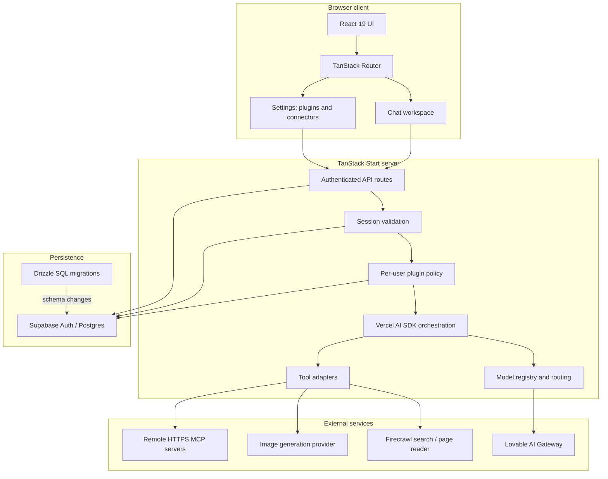

# TeraXGPT system architecture

This document describes the current implementation boundaries, not a promise that every planned capability is already shipped.

## High-level view

## Main request path

1. **Client:** a user submits text and optional supported attachments or selects a mode.
2. **API validation:** the server validates request fields and resolves the authenticated session.
3. **Policy:** server-side plugin preferences and chat-mode restrictions determine which tools and context can be used.
4. **Context assembly:** normal chats may use conversation, project, skill, agent, and saved-memory context according to the request and permissions. Temporary Chat deliberately skips persistent personalization/project context.
5. **Routing:** the model registry chooses a configured model based on task and modality heuristics, unless a model was selected explicitly.
6. **Generation/tool use:** the Vercel AI SDK streams output and coordinates available tool calls.
7. **External tool boundary:** web search and page reading use the configured research integration. Image generation uses the configured provider. MCP calls target remote HTTPS servers and require explicit user approval.
8. **Persistence:** normal conversations and applicable usage data use the app's persistence layer. Temporary Chat avoids writing transcript/conversation records, while operational usage metadata may still be stored without a conversation ID.

## Component responsibilities

| Component | Responsibility |
|---|---|
| React/TanStack client | Chat UI, settings, projects, agents, model selection, mode controls |
| TanStack Start routes | Server-side request validation and orchestration entry points |
| Session/auth helpers | Resolve user identity and protect authenticated API routes |
| Model registry | List configured models, capabilities, and routing heuristics |
| AI Gateway adapter | Send model requests without exposing gateway credentials to the browser |
| Research adapter | Search for web sources and open pages for evidence |
| Image adapter | Invoke the configured image-generation integration |
| MCP adapter | Discover remote tool schemas, decrypt connector credentials server-side, and invoke approved calls |
| Supabase | Authentication and persisted user/application data |
| Drizzle/SQL migrations | Versioned database changes, including connector and plugin settings |

## Trust boundaries and security controls

- **Browser to server:** browser payloads are untrusted. Validate request shape and authenticate every protected operation.
- **User to user:** data access must be scoped to the authenticated user and reinforced by Supabase RLS policies.
- **Model to tools:** model-produced tool arguments are untrusted. Validate schemas and apply policy before execution.
- **App to MCP server:** connector metadata and tool results are untrusted remote input. Remote calls can mutate external systems; keep explicit approval gates.
- **Secrets:** provider keys and the MCP encryption key must remain server-only. Never expose them in client bundles or public logs.
- **Temporary Chat:** do not treat this mode as a complete no-retention guarantee. It avoids transcript persistence in the app but may retain usage metadata; approved external tools may have their own side effects and retention.

## Important current limitations

- The plugin catalogue is first-party and intentionally small; it is not yet a third-party plugin marketplace.
- MCP currently supports remote HTTPS endpoints with bearer-token authentication, not local stdio or interactive OAuth.
- Research is an interactive tool-using chat flow, not a durable background job system with progress events, cancellation, and export.
- The architecture does not currently provide a general-purpose isolated Python/Node execution sandbox.
- Provider capability depends on the model registry and deployment configuration. Do not infer support for a modality merely because the UI can accept an attachment.

## Operational checklist

Before production deployment:

- Apply database migrations in order.
- Set server-only secrets and rotate any previously exposed credentials.
- Run `bun run lint` and `bun run build`.
- Add and run automated tests for auth, RLS isolation, temporary-chat persistence, plugin enforcement, and MCP approvals.
- Test connector URL validation, failure paths, rate limits, and output size limits.
- Confirm logging does not include secrets, private user prompts, or connector bearer tokens.
- Verify backup/retention policies and document incident-response procedures.
